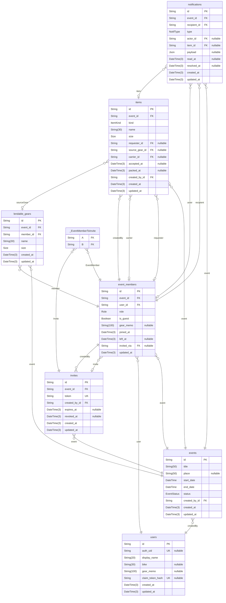

# MotoCamp Pack

> Generated by [`prisma-markdown`](https://github.com/samchon/prisma-markdown)

- [default](#default)

## default

### `users`

アカウント（ゲストは authUid = null）

Properties as follows:

- `id`:
- `auth_uid`: Supabase auth.users.id（uuid）。auth スキーマへのリレーションは張らない
- `display_name`:
- `bike`:
- `gear_memo`: 既定の積載装備メモ
- `claim_token_hash`: ゲストのクレームトークンの SHA-256。紐付け後・失効時は null
- `created_at`:
- `updated_at`:

### `events`

ツーリングのイベント

「終了（完了）」は endDate < 今日（日本時間）からの導出。保存しない

Properties as follows:

- `id`:
- `title`:
- `place`:
- `start_date`:
- `end_date`: 日帰りは startDate と同じ日
- `status`: 既定は PUBLISHED（理由は docs/progress.md「優先順位」）。DRAFT の扱いは docs/screens.md 要確認 7
- `created_by_id`:
- `created_at`:
- `updated_at`:

### `event_members`

イベントへの参加

参加中の判定は常に leftAt: null

実効メモ = member.gearMemo ?? user.gearMemo

アバター色・イニシャルは userId / displayName から決定的に導出（保存しない）

Properties as follows:

- `id`:
- `event_id`:
- `user_id`:
- `role`:
- `is_guest`:
- `gear_memo`: イベント単位の上書き。null なら User.gearMemo
- `joined_at`: 作成日時を兼ねる
- `left_at`: 論理削除。null = 参加中
- `invited_via`: 経由した招待リンク
- `updated_at`:

### `items`

共同装備（SHARED）と貸し借り（RENTAL）を1テーブルで持つ

CHECK 制約 items_requester_kind_check（マイグレーション SQL で追加。docs/schema.md「CHECK 制約」）: RENTAL なら requesterId 必須、SHARED なら requesterId は null

早い者勝ちのため立候補テーブルは持たない。担当は carrierId の1列のみ

Properties as follows:

- `id`:
- `event_id`:
- `kind`:
- `name`:
- `size`:
- `requester_id`: RENTAL のみ（借り手）。SHARED は null
- `source_gear_id`: 登録ギア宛のリクエストなら。null = 宛先なしの募集
- `carrier_id`: 運搬担当。null = 未割り当て
- `accepted_at`: 担当確定時刻。宛先指定の依頼で未承諾なら null
- `packed_at`: 積み込み済み時刻
- `created_by_id`:
- `created_at`:
- `updated_at`:

### `lendable_gears`

イベント内で「貸せます」と登録されたギア

Properties as follows:

- `id`:
- `event_id`:
- `member_id`:
- `name`:
- `size`:
- `created_at`:
- `updated_at`:

### `notifications`

通知（type + 参照ID + payload のみ保存し、文面はクライアントで生成）

Properties as follows:

- `id`:
- `event_id`:
- `recipient_id`: 宛先メンバー
- `type`:
- `actor_id`: 操作した本人
- `item_id`: REQUEST_CANCELLED では null（アイテムが消えるため）
- `payload`: type ごとの補足。形は docs/schema.md「通知の payload」
- `read_at`:
- `resolved_at`: ASK への対応済み（承諾・辞退）
- `created_at`:
- `updated_at`:

### `invites`

招待リンク

Properties as follows:

- `id`:
- `event_id`:
- `token`: 暗号学的乱数で生成（ID とは別の秘密値）
- `created_by_id`:
- `expires_at`:
- `revoked_at`:
- `created_at`:
- `updated_at`:

### `_EventMemberToInvite`

Pair relationship table between [event_members](#event_members) and [invites](#invites)

Properties as follows:

- `A`:
- `B`:
